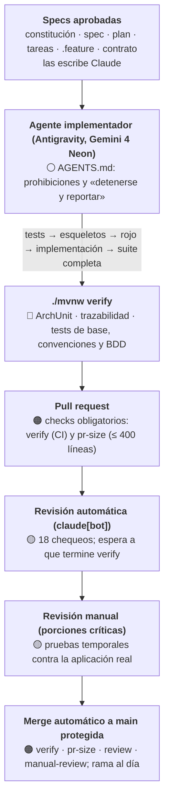

# Reglas y barreras del proyecto

| | |
|---|---|
| **Estado** | Vigente. Se actualiza en el mismo PR que cambia una regla (chequeo 17 de la revisión automática). |
| **Fecha** | 2026-11-26 |
| **Documentos relacionados** | [Constitución](https://github.com/WallKsys/cocos-backend-challenge/blob/main/.specify/memory/constitution.md) · [AGENTS.md](https://github.com/WallKsys/cocos-backend-challenge/blob/main/AGENTS.md) · [RFC](rfc.md) · [Análisis funcional](analisis-funcional.md) · [README](https://github.com/WallKsys/cocos-backend-challenge#readme) |

> Índice de las reglas de arquitectura y de desarrollo que guían al agente implementador. Para cada una indica
> **dónde se decidió, por qué existe y qué la hace cumplir**. Es un índice, no la fuente: el texto que manda está en
> la constitución, en `AGENTS.md`, en los tests y en los scripts enlazados. Si este documento y la constitución
> dicen cosas distintas, manda la constitución y la diferencia es un error de este documento.

---

## 1. Cómo leer este documento

Cada regla tiene un **nivel**: qué tan automático es su cumplimiento.

| Nivel | Significa |
|---|---|
| 🔴 **Build** | Si se viola, `./mvnw verify` falla. Lo detecta una máquina en cada build, local y en CI. |
| 🟠 **Merge** | GitHub no deja mergear: checks obligatorios y protección de `main`. |
| 🟡 **Revisión** | Lo controla la revisión automática (chequeo N de [`pr-review.md`](https://github.com/WallKsys/cocos-backend-challenge/blob/main/.github/claude/pr-review.md)) o la revisión manual. |
| ⚪ **Instrucción** | Está escrito para el agente. Depende de que lo respete y de que una revisión lo note. |
| ⏳ | La barrera automática llega con la spec indicada. Hasta entonces rige el nivel que figura al lado. |

Los IDs (`ARQ-01`, `PRO-05`, ...) son estables: no se renumeran ni se reutilizan. "Const. V.4" es la regla 4 del
principio V de la [constitución](https://github.com/WallKsys/cocos-backend-challenge/blob/main/.specify/memory/constitution.md).

---

## 2. Mapa de barreras

Un cambio pasa por estas barreras, en orden, antes de llegar a `main`:

---

## 3. Catálogo de reglas

### 3.1 Arquitectura (ARQ)

Base: arquitectura hexagonal en tres capas, `domain`, `application` e `infrastructure` (TEC-10, TEC-13). Antes de
mergearse, cada regla de `ArchitectureTest` se vio fallar contra una clase que la violaba a propósito (spec 001,
SC-003; evidencia en el PR #4).

| ID | Regla | Por qué | Decidido en | Se hace cumplir en | Nivel |
|---|---|---|---|---|---|
| ARQ-01 | `domain` depende solo de `domain` y del JDK (dentro de `domain`, `model` y `exception` pueden referirse entre sí). | Las reglas de negocio se prueban sin Spring y no dependen del framework. | TEC-10, Const. V.1 | [`ArchitectureTest`](https://github.com/WallKsys/cocos-backend-challenge/blob/main/src/test/java/com/cocos/challenge/architecture/ArchitectureTest.java) `domain_depends_only_on_domain_and_the_jdk` | 🔴 |
| ARQ-02 | `application` depende solo de `domain`, `application`, el JDK y `@Transactional` (más sus enums `Propagation` e `Isolation`). | Los casos de uso no conocen la infraestructura; el límite transaccional es la única concesión. | TEC-14, Const. V.2 | `application_depends_only_on_domain_application_jdk_and_transactional` | 🔴 |
| ARQ-03 | Las clases de `application` no son componentes de Spring: se registran en `infrastructure.config`. | El cableado queda visible en un solo lugar. | Const. V.2 | `application_classes_are_not_spring_components` | 🔴 |
| ARQ-04 | Todo caso de uso que modifica datos es `@Transactional`; toda consulta es `@Transactional(readOnly = true)`. | Una operación es una transacción. Una consulta que combina varias lecturas (el portfolio) agrega `Isolation.REPEATABLE_READ` para leer una sola foto: con READ COMMITTED, `readOnly` no la garantiza (verificado en `GetPortfolioServiceTest`, spec 006). | TEC-14, Const. V.3 | `command_use_case_methods_are_transactional`, `query_use_case_methods_are_read_only_transactional` | 🔴 |
| ARQ-05 | Solo los adaptadores de persistencia (y `config`) usan Spring JDBC o `java.sql`. Rige el código de producción; el código de test puede usar SQL para preparar datos, verificar y simular actores externos. | Todo el SQL vive en un lugar y se puede revisar. | TEC-12, Const. V.4 (v1.3.9) y VI | `only_persistence_adapters_access_the_database` | 🔴 |
| ARQ-06 | Sin ORM: ni JPA, ni Hibernate, ni Spring Data, ni jOOQ. | Control total del SQL: bloqueos, idempotencia y agregaciones explícitos. | TEC-12, Const. VI | `no_orm_anywhere` | 🔴 |
| ARQ-07 | Los controladores usan solo puertos de entrada; el adaptador REST puede usar `domain.model` y `domain.exception` (para traducir errores). | El adaptador REST no puede saltear los casos de uso. | Const. V.5 | `rest_adapters_use_only_inbound_ports` | 🔴 |
| ARQ-08 | Los DTOs REST no salen del adaptador REST, y ningún controlador devuelve objetos de dominio. | El contrato de la API no queda atado al modelo interno. | Const. V.6 | `rest_dtos_do_not_leave_the_rest_adapter`, `controllers_never_return_domain_objects` | 🔴 |
| ARQ-09 | Sin ciclos entre las capas `domain`, `application` e `infrastructure`. | Dependencias en una sola dirección. | Const. V.7 | `no_cycles_between_layers` | 🔴 |
| ARQ-10 | Ningún campo ni retorno `double`/`float` (ni sus envoltorios) en `domain`, `application` ni REST. | El dinero es exacto (ver DAT-05). | Const. V.8 y VIII | `no_floating_point_fields`, `no_floating_point_return_types` | 🔴 |
| ARQ-11 | Solo `infrastructure` usa Micrometer u OpenTelemetry; `application` registra hechos de negocio a través del puerto `BusinessMetrics`. | Las métricas no contaminan los casos de uso. | TEC-31, Const. V.9 | `only_infrastructure_uses_metrics_libraries` | 🔴 |
| ARQ-12 | Solo Jackson 3 (`tools.jackson.*`); nunca `com.fasterxml.jackson.databind`. | Trampa típica de Spring Boot 3 → 4. | TEC-11, Const. "Spring Boot 4 pitfalls" | `no_jackson_2_databind` | 🔴 |
| ARQ-13 | Los controladores internos viven en `rest.internal` y llevan `@ConditionalOnProperty`; ningún otro controlador mapea `/api/internal`. | Las herramientas internas quedan fuera del alcance del challenge y apagadas por defecto. | TEC-18, spec 003 FR-003 | [`InternalToolsArchitectureTest`](https://github.com/WallKsys/cocos-backend-challenge/blob/main/src/test/java/com/cocos/challenge/architecture/InternalToolsArchitectureTest.java) (2 reglas) | 🔴 |
| ARQ-14 | Las reglas de ArchUnit no se modifican ni se debilitan. | Son la ley de la arquitectura; un agente tendería a ajustarlas a su código. | TEC-05, TEC-09, Const. V | Chequeo 6 ("`ArchitectureTest` untouched") | 🟡 |
| ARQ-15 | Toda excepción de dominio mapeada a un código hereda directamente de `DomainException`; ninguna es subclase de otra mapeada. Se registra en los dos lugares del manejador. Desde la spec 011, `DomainException` es sellada, sus seis subclases son `non-sealed` y el manejador la resuelve con un `switch` exhaustivo, sin `default`; una subclase de una de ellas usa el código de su padre (lo prueba `ErrorHandlingIT`). | El manejador resuelve el código con `isInstance` sobre un mapa sin orden: con herencia entre mapeadas, el código devuelto dependería del azar. Con la clase sellada, una excepción sin su `case` no compila. | Revisión de planes 004–010, specs 004 y 009; TEC-38 | Revisión; desde la porción 011-a, el compilador | 🟡 → 🔴 ⏳ 011 |
| ARQ-16 | Todo puerto de entrada se llama `*UseCase` (modifica datos) o `*Query` (solo lectura). | ARQ-04 encuentra los casos de uso por el nombre del puerto: uno con otro nombre escaparía a la exigencia de `@Transactional`. | TEC-13, TEC-14, Const. V.3 (v1.3.7) | [`ArchitectureGuardsTest`](https://github.com/WallKsys/cocos-backend-challenge/blob/main/src/test/java/com/cocos/challenge/architecture/ArchitectureGuardsTest.java) `inbound_ports_are_named_use_case_or_query` | 🔴 |
| ARQ-17 | El tipo de retorno de un controlador no incluye tipos del dominio, ni siquiera dentro de genéricos (`ResponseEntity<Order>`). | ARQ-08 solo mira el tipo crudo y dejaba pasar el dominio envuelto. | TEC-13, Const. V.6 (v1.3.7) | `ArchitectureGuardsTest` `controllers_never_return_domain_objects_inside_generics` | 🔴 |
| ARQ-18 | Un DTO REST (record del adaptador REST, de pedido o de respuesta) no tiene campos con tipos del dominio, ni siquiera enums ni dentro de genéricos: lleva tipos del JDK y otros DTOs. | Con `Money` o un enum en el DTO, Jackson serializaría el dominio (el contrato cambiaría al renombrar una constante) o, en un pedido, respondería con sus propios mensajes de error en lugar de los del catálogo. | TEC-13, TEC-20, Const. V.6 (v1.3.7) | `ArchitectureGuardsTest` `rest_dtos_do_not_hold_domain_types` | 🔴 |

### 3.2 Datos y dinero (DAT)

| ID | Regla | Por qué | Decidido en | Se hace cumplir en | Nivel |
|---|---|---|---|---|---|
| DAT-01 | La tabla `orders` es el libro contable: efectivo, reservas, posiciones y costo promedio se derivan siempre de ella. | Una sola fuente de verdad; nada que se desincronice. | TEC-17, Const. I | [`LedgerReferenceQueriesIT`](https://github.com/WallKsys/cocos-backend-challenge/blob/main/src/test/java/com/cocos/challenge/database/LedgerReferenceQueriesIT.java) (fórmulas de referencia sobre los datos provistos); [`JdbcLedgerReaderIT`](https://github.com/WallKsys/cocos-backend-challenge/blob/main/src/test/java/com/cocos/challenge/infrastructure/adapter/out/persistence/JdbcLedgerReaderIT.java) (efectivo, reservas y tenencias; spec 005), [`JdbcPortfolioReaderIT`](https://github.com/WallKsys/cocos-backend-challenge/blob/main/src/test/java/com/cocos/challenge/infrastructure/adapter/out/persistence/JdbcPortfolioReaderIT.java) (posiciones abiertas; spec 006) y [`JdbcCashMovementRepositoryIT`](https://github.com/WallKsys/cocos-backend-challenge/blob/main/src/test/java/com/cocos/challenge/infrastructure/adapter/out/persistence/JdbcCashMovementRepositoryIT.java) (depósitos y retiros guardados como órdenes; spec 007) | 🔴 |
| DAT-02 | Las órdenes `NEW` reservan lo que comprometen y toda validación usa el saldo **disponible**. Ninguna operación aceptada deja un disponible negativo. | Un broker no puede vender dos veces la misma plata ni las mismas acciones. | DEC-01, D-07, Const. I | [`OrderEvaluatorTest`](https://github.com/WallKsys/cocos-backend-challenge/blob/main/src/test/java/com/cocos/challenge/domain/service/OrderEvaluatorTest.java) y [`CashMovementEvaluatorTest`](https://github.com/WallKsys/cocos-backend-challenge/blob/main/src/test/java/com/cocos/challenge/domain/service/CashMovementEvaluatorTest.java) (lo reservado no se puede gastar); `JdbcLedgerReaderIT` (una venta `LIMIT` nueva reserva acciones); escenarios `INSUFFICIENT_FUNDS` e `INSUFFICIENT_SHARES` de [`cu-03-order-placement.feature`](https://github.com/WallKsys/cocos-backend-challenge/blob/main/src/test/resources/features/cu-03-order-placement.feature); pedidos simultáneos que no gastan dos veces el mismo efectivo: [`ConcurrentOrdersIT`](https://github.com/WallKsys/cocos-backend-challenge/blob/main/src/test/java/com/cocos/challenge/infrastructure/adapter/in/rest/order/ConcurrentOrdersIT.java) y [`IdempotencyLoadIT`](https://github.com/WallKsys/cocos-backend-challenge/blob/main/src/test/java/com/cocos/challenge/infrastructure/adapter/in/rest/order/IdempotencyLoadIT.java); chequeo 10 | 🔴 |
| DAT-03 | Las acciones son siempre enteras. | Regla del mercado (R-08). | DEC-14, Const. I | [`SchemaConstraintsIT`](https://github.com/WallKsys/cocos-backend-challenge/blob/main/src/test/java/com/cocos/challenge/database/SchemaConstraintsIT.java) (`orders_whole_shares_check`); tipos enteros en el JSON (API-04) | 🔴 |
| DAT-04 | Un pedido inválido se responde con error y **no se guarda nada**. | Separar "orden rechazada" (se guarda) de "pedido inválido" (no existe). | DEC-05, Const. I | [`OrderControllerIT`](https://github.com/WallKsys/cocos-backend-challenge/blob/main/src/test/java/com/cocos/challenge/infrastructure/adapter/in/rest/order/OrderControllerIT.java) (cantidad fraccionaria, sin clave o con `userId` en el cuerpo: ninguna orden guardada); [`PlaceOrderServiceTest`](https://github.com/WallKsys/cocos-backend-challenge/blob/main/src/test/java/com/cocos/challenge/application/service/PlaceOrderServiceTest.java) (instrumento desconocido); chequeo 10 | 🔴 |
| DAT-05 | El dinero es `BigDecimal` con escala 2 y `HALF_UP`, envuelto en `Money`. | Exactitud: nunca errores de punto flotante. | Const. VIII | [`MoneyTest`](https://github.com/WallKsys/cocos-backend-challenge/blob/main/src/test/java/com/cocos/challenge/domain/model/MoneyTest.java) y ARQ-10 | 🔴 |
| DAT-06 | Las columnas de dinero son `NUMERIC(18,2)`. | Rango y precisión fijos en la base. | CM-09 | Migraciones de la spec 002; `SchemaConstraintsIT` (monto `99999999999.99`) | 🔴 |
| DAT-07 | SQL escrito a mano en text blocks con parámetros con nombre; nunca concatenar valores. | Evitar inyección SQL y mantener las consultas legibles. | TEC-12, Const. VI | Chequeo 7 | 🟡 |
| DAT-08 | Las agregaciones se calculan en SQL; nunca se cargan las órdenes en memoria para sumarlas. | Rendimiento con 10 M de órdenes (RSK-01, M-08 a M-11). | TEC-17, TEC-24, Const. VI | [`PlanGuardIT`](https://github.com/WallKsys/cocos-backend-challenge/blob/main/src/test/java/com/cocos/challenge/infrastructure/adapter/out/persistence/PlanGuardIT.java) (spec 009, `EXPLAIN` con `enable_seqscan = off`); [`VolumeIT`](https://github.com/WallKsys/cocos-backend-challenge/blob/main/src/test/java/com/cocos/challenge/volume/VolumeIT.java) (perfil `-Pvolume`, manual) | 🔴 |
| DAT-09 | `V1` es copia byte a byte del `database.sql` provisto, y una migración ya commiteada nunca se edita. | Partir de los datos originales y mantener la historia de Flyway reproducible. | CM-xx, Const. VI | [`OriginalScriptIsUnchangedTest`](https://github.com/WallKsys/cocos-backend-challenge/blob/main/src/test/java/com/cocos/challenge/database/OriginalScriptIsUnchangedTest.java) (V1); V2 en adelante: chequeo 2 (`cmp` contra `specs/002-database/migrations/`) | 🔴 V1 · 🟡 resto |
| DAT-10 | Las fechas se guardan y se devuelven en UTC (ISO 8601 con `Z`); la conversión a hora local es del consumidor. | Sin ambigüedad de zona horaria. | DEC-18, Const. IX | [`TimestampsAndSearchColumnsIT`](https://github.com/WallKsys/cocos-backend-challenge/blob/main/src/test/java/com/cocos/challenge/database/TimestampsAndSearchColumnsIT.java); formato JSON en [`FormatsIT`](https://github.com/WallKsys/cocos-backend-challenge/blob/main/src/test/java/com/cocos/challenge/conventions/FormatsIT.java) | 🔴 |
| DAT-11 | Restricciones de integridad en la base: lados, tipos, estados, códigos de rechazo, par clave/huella de idempotencia, tamaño no negativo. | La base es la última red de seguridad. | CM-04, CM-10, CM-11 | `SchemaConstraintsIT` (14 casos) | 🔴 |
| DAT-12 | Cada sentencia SQL es una constante package-private de su adaptador; la búsqueda y el historial, que se arman por fragmentos, exponen un método package-private que construye la sentencia. | La guardia de planes ejecuta `EXPLAIN` sobre el SQL real; sin esto, la spec 009 tendría que refactorizar seis adaptadores. | Revisión de planes 004–010, specs 004 a 009 | Chequeo 1 (tareas del plan). Hecho en la búsqueda: `JdbcInstrumentSearchRepository.sql(criteria)` (spec 004). [`PlanGuardIT`](https://github.com/WallKsys/cocos-backend-challenge/blob/main/src/test/java/com/cocos/challenge/infrastructure/adapter/out/persistence/PlanGuardIT.java) ejecuta `EXPLAIN` sobre esas constantes (spec 009) | 🔴 |

### 3.3 Concurrencia e idempotencia (CON)

| ID | Regla | Por qué | Decidido en | Se hace cumplir en | Nivel |
|---|---|---|---|---|---|
| CON-01 | Toda operación que modifica datos bloquea primero la fila del usuario (`SELECT id FROM users WHERE id = :userId FOR UPDATE`): exactamente una fila, siempre como primer paso. | Serializa las operaciones de un usuario sin riesgo de deadlocks. | TEC-16, Const. VII | [`JdbcAccountLockIT`](https://github.com/WallKsys/cocos-backend-challenge/blob/main/src/test/java/com/cocos/challenge/infrastructure/adapter/out/persistence/JdbcAccountLockIT.java); porción 005-f: `ConcurrentOrdersIT` (la compra que compite espera el bloqueo de la cuenta) y `IdempotencyLoadIT`; porción 008-b: [`CancellationLoadIT`](https://github.com/WallKsys/cocos-backend-challenge/blob/main/src/test/java/com/cocos/challenge/infrastructure/adapter/in/rest/order/CancellationLoadIT.java) (50 cancelaciones simultáneas) y [`CancelVersusExecutionIT`](https://github.com/WallKsys/cocos-backend-challenge/blob/main/src/test/java/com/cocos/challenge/infrastructure/adapter/in/rest/order/CancelVersusExecutionIT.java); revisión manual de 005-c y 005-d | 🔴 |
| CON-02 | Flujo fijo: validar (lo que no necesita datos) → bloquear → buscar la clave de idempotencia → validar lo que necesita datos → calcular disponibles → aplicar reglas → guardar. Un pedido inválido no consume la clave. La cancelación y las herramientas internas no llevan clave. | Un reintento nunca ejecuta dos veces y un error de validación no "quema" la clave. | TEC-16, Const. VII | `PlaceOrderServiceTest` (orden de las llamadas; un pedido inválido deja la clave libre) y [`CashMovementServiceTest`](https://github.com/WallKsys/cocos-backend-challenge/blob/main/src/test/java/com/cocos/challenge/application/service/CashMovementServiceTest.java) (spec 007); chequeo 10 | 🔴 |
| CON-03 | Una sola clave de idempotencia por usuario para todas las operaciones, con restricción única en la base. | Una regla simple; la base garantiza la unicidad aunque falle el código. | DEC-23, TEC-32, CM-02 | `SchemaConstraintsIT` (casos 10 a 12) | 🔴 |
| CON-04 | Misma clave y mismo pedido → `200` con `Idempotent-Replayed: true`; misma clave y otro pedido → `422 IDEMPOTENCY_CONFLICT`. | El cliente puede reintentar con seguridad y detectar el mal uso de una clave. | DEC-09, Const. VII | [`IdempotencyKeyIT`](https://github.com/WallKsys/cocos-backend-challenge/blob/main/src/test/java/com/cocos/challenge/conventions/IdempotencyKeyIT.java) (header de reintento); escenarios CU-03.31 y CU-03.32 de `cu-03-order-placement.feature`; `IdempotencyLoadIT` (50 pedidos simultáneos con la misma clave se ejecutan una vez) y [`CashIdempotencyIT`](https://github.com/WallKsys/cocos-backend-challenge/blob/main/src/test/java/com/cocos/challenge/infrastructure/adapter/in/rest/cash/CashIdempotencyIT.java) (spec 007) | 🔴 |
| CON-05 | `Idempotency-Key` se lee solo a través de `@IdempotencyKeyHeader`: obligatoria, de 1 a 255 caracteres ASCII visibles. Si llega más de una vez, se rechaza. | Una única validación para todas las operaciones. | Spec 003 US4 y FR-004, DEC-27 | `IdempotencyKeyIT` (incluye un pedido HTTP crudo por socket para los caracteres no ASCII); lectura en un solo lugar: revisión manual; header repetido: `IdempotencyKeyIT` (porción 003-f, por socket) | 🔴 · 🟡 |
| CON-06 | Las consultas nunca bloquean. | Las lecturas no frenan a las operaciones. | Const. VII | Revisión manual | 🟡 |

### 3.4 API (API)

| ID | Regla | Por qué | Decidido en | Se hace cumplir en | Nivel |
|---|---|---|---|---|---|
| API-01 | Todo texto de la API está en inglés, aunque el pedido traiga `Accept-Language: es`. | Un solo idioma para clientes y logs. | TEC-19, Const. IX | [`ErrorHandlingIT`](https://github.com/WallKsys/cocos-backend-challenge/blob/main/src/test/java/com/cocos/challenge/conventions/ErrorHandlingIT.java) (locale fijo y `Accept-Language: es`); textos exactos en cada test | 🔴 |
| API-02 | Errores en formato RFC 9457 con un `code` estable, de un catálogo cerrado: no se agregan códigos sin una spec. | El cliente decide qué hacer por el `code`; la persona entiende por el `detail`. | TEC-19, RNF-06, Const. IX | `ErrorHandlingIT`; catálogo cerrado: chequeo 9 | 🔴 · 🟡 |
| API-03 | Un error 500 nunca expone detalles internos. | Seguridad. | Spec 003 US1 | `ErrorHandlingIT.unexpectedExceptionNeverLeaksItsMessage` | 🔴 |
| API-04 | JSON estricto: se rechazan los campos desconocidos y no se convierte `1.5`, `"10"` ni `10.0` a entero, ni un número a texto. Un número que no entra en su campo (`{"quantity": 99999999999}`) nombra el campo en lugar de responder "Malformed JSON". | Jackson truncaba `1.5` a `1`: se habría ejecutado una orden por otra cantidad. | DEC-24, Const. IX, spec 003 § Jackson, DEC-28 | `ErrorHandlingIT`, [`FormatsIT`](https://github.com/WallKsys/cocos-backend-challenge/blob/main/src/test/java/com/cocos/challenge/conventions/FormatsIT.java); desbordes: `ErrorHandlingIT` (porción 003-f) | 🔴 |
| API-05 | Montos, precios y porcentajes viajan como texto: las respuestas con exactamente 2 decimales y los pedidos con hasta 2 (`MoneyInput`); las cantidades, como enteros. Hasta 16 dígitos enteros, salvo `totalAmount` de una orden, hasta 26 (`MoneyTotal`). | Precisión al cruzar JSON. Una orden rechazada conserva cantidad y precio, y su producto puede pasar de 16 dígitos. | TEC-20, Const. VIII, DEC-31 | [`FormatsIT`](https://github.com/WallKsys/cocos-backend-challenge/blob/main/src/test/java/com/cocos/challenge/conventions/FormatsIT.java), [`ApiDecimalsTest`](https://github.com/WallKsys/cocos-backend-challenge/blob/main/src/test/java/com/cocos/challenge/infrastructure/adapter/in/rest/format/ApiDecimalsTest.java), [`DecimalStringValidatorTest`](https://github.com/WallKsys/cocos-backend-challenge/blob/main/src/test/java/com/cocos/challenge/infrastructure/adapter/in/rest/format/DecimalStringValidatorTest.java) | 🔴 |
| API-06 | El usuario sale solo de `X-User-Id`, leído por `@RequesterId`; las URLs nunca llevan el id del usuario y el recurso de otro usuario responde igual que uno inexistente. Un pedido con dos headers `X-User-Id` se rechaza, aunque los valores coincidan. | Aislamiento por construcción. | TEC-18, DEC-17, Const. IX, DEC-27 | [`IdentityAndAdminIT`](https://github.com/WallKsys/cocos-backend-challenge/blob/main/src/test/java/com/cocos/challenge/conventions/IdentityAndAdminIT.java); lectura en un solo lugar: revisión manual; header repetido: `IdentityAndAdminIT` (porción 003-f, por socket) | 🔴 · 🟡 |
| API-07 | Las herramientas internas (`/api/internal/**`) exigen `X-Role: ADMIN` y se activan por configuración. Sin el rol, cualquier método responde el mismo 404 que una ruta inexistente, porque el rol se controla antes de buscar la ruta. | No revelar que existen. | TEC-18, spec 003 US3, PR #21 | `IdentityAndAdminIT`, [`InternalToolsDisabledIT`](https://github.com/WallKsys/cocos-backend-challenge/blob/main/src/test/java/com/cocos/challenge/conventions/InternalToolsDisabledIT.java), ARQ-13 | 🔴 |
| API-08 | Una orden `REJECTED` no es un error HTTP: responde `201` con `rejection.code` y `rejection.message`. | El rechazo es un resultado de negocio y queda guardado. | DEC-12, Const. IX | Escenarios `REJECTED` de `cu-03-order-placement.feature`: el paso `the order is created with status` exige `201` y la orden guardada | 🔴 |
| API-09 | Paginación por cursor (`cursor`, `limit`, `nextCursor`). | Páginas estables aunque lleguen órdenes nuevas. | CM-08, Const. IX | Escenarios CU-02.12 y CU-07.07 (recorrer todas las páginas devuelve cada elemento una vez); [`SearchCursorTest`](https://github.com/WallKsys/cocos-backend-challenge/blob/main/src/test/java/com/cocos/challenge/domain/model/SearchCursorTest.java) y [`HistoryCursorTest`](https://github.com/WallKsys/cocos-backend-challenge/blob/main/src/test/java/com/cocos/challenge/domain/model/HistoryCursorTest.java); cursor inválido en `InstrumentSearchControllerIT` y `OrderQueryControllerIT` | 🔴 |
| API-10 | Los parámetros de URL inválidos o faltantes tienen textos fijos (`has an invalid type or format`, `is required`). | Un solo estilo de error. | DEC-25 | [`ErrorHandlingIT`](https://github.com/WallKsys/cocos-backend-challenge/blob/main/src/test/java/com/cocos/challenge/conventions/ErrorHandlingIT.java) (endpoint de prueba `/required-param`, tarea T015a); `limit=abc` en [`InstrumentSearchControllerIT`](https://github.com/WallKsys/cocos-backend-challenge/blob/main/src/test/java/com/cocos/challenge/infrastructure/adapter/in/rest/instrument/InstrumentSearchControllerIT.java); `/api/v1/orders/abc` en [`OrderQueryControllerIT`](https://github.com/WallKsys/cocos-backend-challenge/blob/main/src/test/java/com/cocos/challenge/infrastructure/adapter/in/rest/order/OrderQueryControllerIT.java) | 🔴 |
| API-11 | El contrato OpenAPI publicado es copia exacta del contrato de la última spec implementada (identificada por su `info.version`), y sus rutas coinciden con las de la aplicación. | Contract-first: el contrato no miente. | TEC-22, Const. IX | [`PublishedContractIsLatestSpecContractTest`](https://github.com/WallKsys/cocos-backend-challenge/blob/main/src/test/java/com/cocos/challenge/contract/PublishedContractIsLatestSpecContractTest.java), [`PublishedContractMatchesRoutesIT`](https://github.com/WallKsys/cocos-backend-challenge/blob/main/src/test/java/com/cocos/challenge/contract/PublishedContractMatchesRoutesIT.java), [`PublishedContractEndpointsIT`](https://github.com/WallKsys/cocos-backend-challenge/blob/main/src/test/java/com/cocos/challenge/contract/PublishedContractEndpointsIT.java) (`/openapi/openapi.yaml` y Swagger UI) | 🔴 |
| API-12 | Toda respuesta lleva `X-Request-Id`; un id entrante inválido se reemplaza y nunca se refleja. | Correlación de logs sin inyección. | TEC-27 | [`RequestIdIT`](https://github.com/WallKsys/cocos-backend-challenge/blob/main/src/test/java/com/cocos/challenge/conventions/RequestIdIT.java), [`ProblemResponses`](https://github.com/WallKsys/cocos-backend-challenge/blob/main/src/test/java/com/cocos/challenge/conventions/ProblemResponses.java) | 🔴 |
| API-13 | Las métricas nunca se etiquetan con id de usuario, id de orden, clave de idempotencia ni ticker. | Cardinalidad acotada. | TEC-31, Const. "Technology Stack" | [`MicrometerBusinessMetricsTest`](https://github.com/WallKsys/cocos-backend-challenge/blob/main/src/test/java/com/cocos/challenge/infrastructure/adapter/out/metrics/MicrometerBusinessMetricsTest.java) (ninguna etiqueta prohibida) | 🔴 |
| API-14 | Un id de la ruta (`orderId`, `userId`, `instrumentId`) 0 o negativo responde 400 `Request validation failed: '<id>' must be greater than 0.`; uno que no es número o no entra en su tipo sigue API-10. | El contrato declara `minimum: 1`: un 0 lo viola y es un error de validación, no "no encontrado". | DEC-26 | [`InternalPortfolioControllerIT`](https://github.com/WallKsys/cocos-backend-challenge/blob/main/src/test/java/com/cocos/challenge/infrastructure/adapter/in/rest/internal/InternalPortfolioControllerIT.java) (spec 006); `OrderQueryControllerIT` y [`InternalOrderHistoryControllerIT`](https://github.com/WallKsys/cocos-backend-challenge/blob/main/src/test/java/com/cocos/challenge/infrastructure/adapter/in/rest/internal/InternalOrderHistoryControllerIT.java) (spec 008); [`InternalToolsControllerIT`](https://github.com/WallKsys/cocos-backend-challenge/blob/main/src/test/java/com/cocos/challenge/infrastructure/adapter/in/rest/internal/InternalToolsControllerIT.java) (spec 009) | 🔴 |
| API-15 | Cada operación del cliente con efecto (orden, cancelación, depósito, retiro) que termina con respuesta escribe una línea INFO `Operation completed` con `operation`, `userId`, `orderId`, clave de idempotencia, `result`, `rejectionReason` y `replayed`, desde el adaptador REST; llega a Loki con el `requestId` y el `trace_id`. | Seguir una operación de punta a punta (PRD RNF-04); los logs no son etiquetas, así que la cardinalidad no importa. | TEC-27, spec 010 FR-006 | [`OperationLogIT`](https://github.com/WallKsys/cocos-backend-challenge/blob/main/src/test/java/com/cocos/challenge/observability/OperationLogIT.java) y [`ObservabilityIT`](https://github.com/WallKsys/cocos-backend-challenge/blob/main/src/test/java/com/cocos/challenge/observability/ObservabilityIT.java) (porciones 010-c1 y 010-c2) | 🔴 |

### 3.5 Proceso de desarrollo (PRO)

| ID | Regla | Por qué | Decidido en | Se hace cumplir en | Nivel |
|---|---|---|---|---|---|
| PRO-01 | La spec es la ley: no se inventan endpoints, campos, códigos ni mensajes, ni funcionalidades que ninguna spec pide. | Un agente tiende a "completar" lo que falta. | Const. II, AGENTS.md | Chequeos 1 y 9 | 🟡 |
| PRO-02 | Ante una ambigüedad, una contradicción o un test que parece mal, el agente se detiene y reporta. | Adivinar es la fuente principal de alucinaciones. | Const. II, AGENTS.md | Instrucción. Funcionó: el agente se detuvo en las porciones 003-c (tamaño, PR #19) y 003-c2 (headers, PR #22) | ⚪ |
| PRO-03 | Test-first en cada porción: tests → esqueletos → confirmar que fallan por el motivo esperado → implementar → suite completa. En una spec que se declara refactor sin cambio de comportamiento (la 011) no hay rojo: los tests cambian solo por ajustes mecánicos que su `tasks.md` prescribe, y cada porción prueba que el SQL y los tests ejecutados son los de la línea de base. | Un test que nunca se vio fallar no prueba nada. En un refactor no hay comportamiento nuevo que ver fallar: la suite existente es la especificación. | TEC-08, TEC-38, Const. III | Chequeos 4 y 15 (orden de commits); la revisión manual vuelve a correr el rojo. En la 011, la salida de [`preservation.sh`](https://github.com/WallKsys/cocos-backend-challenge/blob/main/specs/011-consolidation/preservation.sh) pegada en el PR | 🟡 |
| PRO-04 | Los tests aprobados y los `.feature` no se modifican, desactivan ni debilitan. Un ajuste posterior al rojo se documenta en el PR con su motivo. Excepción: un cambio que el `tasks.md` de la porción prescribe para un archivo de test nombrado (por ejemplo, la lista de migraciones de `SeedDataIT`); la prescripción cuenta solo si ya está en el `tasks.md` de `main` (PRO-18). | Evita "arreglar" un test para que pase. | TEC-09, Const. III | Chequeos 3 y 18 | 🟡 |
| PRO-05 | Cada escenario `CU-xx.yy` tiene exactamente un escenario Gherkin y al menos un test etiquetado (`unit` o `integration`). | Ningún escenario queda sin verificar. | TEC-06, TEC-07, Const. IV | [`TraceabilityTest`](https://github.com/WallKsys/cocos-backend-challenge/blob/main/src/test/java/com/cocos/challenge/traceability/TraceabilityTest.java): 10 tipos de violación, probados por `TraceabilityCheckerTest`; lee los tags como JUnit (directos, de meta-anotaciones como `@IntegrationTest` y heredados), probado por `TestTagsTest`; el alcance crece spec a spec en [`scope.txt`](https://github.com/WallKsys/cocos-backend-challenge/blob/main/src/test/resources/traceability/scope.txt) | 🔴 |
| PRO-06 | Los `.feature` se copian byte a byte desde `specs/NNN-*/features/`. | El escenario ejecutado es el aprobado. | Const. IV | [`FeaturesMatchSpecsTest`](https://github.com/WallKsys/cocos-backend-challenge/blob/main/src/test/java/com/cocos/challenge/traceability/FeaturesMatchSpecsTest.java); chequeo 2 | 🔴 |
| PRO-07 | Un PR tiene como máximo 400 líneas contadas, o una sección `## Size justification`. | Que una persona lo pueda revisar. | TEC-30, Const. X | [`check-pr-size.sh`](https://github.com/WallKsys/cocos-backend-challenge/blob/main/scripts/check-pr-size.sh) en el check obligatorio `pr-size` | 🟠 |
| PRO-08 | Todo PR deja la suite completa en verde. | `main` siempre funciona. | Const. X, TEC-33 | Check obligatorio `verify` | 🟠 |
| PRO-09 | Una porción por PR, en una rama `NNN-nombre-<letra>` creada desde `main` actualizada; las specs se implementan en orden. | PRs chicos y trazables. | TEC-21, TEC-28 | Chequeo 1; protección de `main` (rama al día) | 🟡 |
| PRO-10 | Formato de commit `[NNN][T0xx] descripción (CU-xx.yy, DEC-xx)`. | Trazabilidad de cada commit a su tarea. | Const. "Development Workflow" | No se verifica | ⚪ |
| PRO-11 | No se agregan ni se actualizan dependencias fuera del plan; las versiones están fijadas. | Evita APIs inexistentes y cambios no revisados. | TEC-11, Const. "Technology Stack" | Chequeo 11 | 🟡 |
| PRO-12 | Tabla de trampas de Spring Boot 4 (starters, Jackson 3, `@MockitoBean`, propiedades OTLP, versión del appender). | Los modelos tienden a escribir código de Spring Boot 3. | TEC-11, Const. "Spring Boot 4 pitfalls" | ARQ-12; el resto falla al compilar o al arrancar | 🔴 parcial · ⚪ |
| PRO-13 | Los artefactos para el agente están en inglés; la documentación para personas, en español; los IDs son idénticos. | Los modelos siguen mejor las instrucciones en inglés. | TEC-29 | Instrucción | ⚪ |
| PRO-14 | La plantilla del PR se completa con salidas reales (rojo, tamaño, CI), y lo que afirma coincide con la evidencia. | Lo declarado tiene que poder comprobarse. | TEC-34 | Chequeos 14 y 16 | 🟡 |
| PRO-15 | Los esqueletos mantienen funcionando los pedidos que no prueban (un filtro esqueleto deja pasar el pedido). | Que el rojo apunte al comportamiento que falta y no a un error general. | Revisión del PR #23 | `AGENTS.md` § Slice protocol | ⚪ |
| PRO-16 | Protocolo de porción: el dueño solo indica qué hacer en una línea ("Implement the next slice"); el agente elige la porción (la primera sin tareas marcadas en `main`), no empieza sobre una porción con PR abierto, sigue los cortes predefinidos sin frenar y revisa su PR contra `pr-review.md` antes de abrirlo. | Las mismas instrucciones dejan de repetirse en cada prompt, donde podían olvidarse o variar; la autorrevisión evita una vuelta de revisión. | Decisión del dueño (2026-11-23) | [`AGENTS.md`](https://github.com/WallKsys/cocos-backend-challenge/blob/main/AGENTS.md) § Slice protocol; chequeos 1, 4, 14 y 15 | ⚪ · 🟡 |
| PRO-17 | El agente no edita `docs/` ni `README.md`. Las filas ⏳ que entrega una porción las actualiza el autor de las specs, una vez por spec. | La documentación para personas tiene un solo autor; un agente que la toca para cumplir una regla agrega ruido. | TEC-05; hallazgo del PR #40 | `AGENTS.md`; chequeo 17 (bloqueante si un PR de porción edita `docs/` o el README) | 🟡 |
| PRO-18 | `specs/` es de solo lectura para el agente: el único cambio permitido es marcar las tareas de su porción en `tasks.md`. Sin notas, sin reescribir tareas, sin marcar otras casillas; lo que quiera explicar va en la descripción del PR. | Las specs son la fuente de verdad. Si el agente pudiera editarlas, podría escribirse la prescripción que habilita cambiar un test (PRO-04) o ajustar una tarea a lo que hizo. | Const. (fuentes de verdad, v1.3.8), TEC-09; hallazgos de las porciones 005-c1 y 005-e1 | `AGENTS.md`; chequeo 18 (bloqueante en un PR de porción) | 🟡 |

### 3.6 Revisión y repositorio (REV)

| ID | Regla | Por qué | Decidido en | Se hace cumplir en | Nivel |
|---|---|---|---|---|---|
| REV-01 | Quien implementa no revisa. El agente implementador (Antigravity con Gemini 4 Neon desde la porción 008-c2; antes OpenCode, y Kimi desde IntelliJ en las porciones 004-b2 y 004-c1) escribe el código y sus tests; Claude escribe specs, `.feature` y reglas de ArchUnit, y revisa. Claude nunca implementa lo que después revisa, y el modelo del agente implementador no puede ser de Claude. | Revisión adversarial: sin contexto ni puntos ciegos compartidos. | TEC-03, TEC-05 | Proceso | ⚪ |
| REV-02 | `main` protegida: PR obligatorio incluso para administradores, checks obligatorios `verify`, `pr-size`, `review` y `manual-review`, rama al día, conversaciones resueltas, sin force push ni borrado. | Nada llega a `main` sin pasar por las barreras. | TEC-28, TEC-30, TEC-33, TEC-35 | Protección de rama en GitHub | 🟠 |
| REV-03 | La CI corre `./mvnw verify` en cada PR y en cada push a `main`. | El build verde no depende de la máquina de nadie. | TEC-33 | [`ci.yml`](https://github.com/WallKsys/cocos-backend-challenge/blob/main/.github/workflows/ci.yml) | 🟠 |
| REV-04 | Cada PR recibe una revisión automática formal (aprobar o pedir cambios), después de que termina `verify`. El check `review` falla si no aprueba el último commit, y es obligatorio (TEC-35). | Revisión siempre, sin depender de una sesión abierta. | TEC-34 | [`claude-review.yml`](https://github.com/WallKsys/cocos-backend-challenge/blob/main/.github/workflows/claude-review.yml) y [`pr-review.md`](https://github.com/WallKsys/cocos-backend-challenge/blob/main/.github/claude/pr-review.md) (18 chequeos) | 🟠 |
| REV-05 | El contenido del PR se trata como dato no confiable y el revisor tiene herramientas mínimas. | Prevenir prompt injection. | TEC-34 | `pr-review.md` § Security; `--allowedTools` del workflow | 🟡 |
| REV-06 | Las porciones críticas tienen además una revisión manual (tabla abajo). | Lo que un test no cubre se ve probando la aplicación real. | TEC-03 | Marca `**Manual review**: required` en el `tasks.md` de cada porción crítica, leída desde `main` por el check obligatorio `manual-review`; pasa solo con la etiqueta `manual-review-approved`, que se agrega al aprobar la revisión manual y se quita con cada push (TEC-35) | 🟠 |
| REV-07 | El agente no edita las barreras: `.github/claude/`, `.github/workflows/` ni `scripts/check-pr-size.sh`. | Una barrera que el vigilado puede cambiar no es una barrera. | AGENTS.md | Chequeo 17 (bloqueante en un PR de porción). La revisión lee sus instrucciones, y `pr-size` su script, desde `main`: un PR no puede cambiar las reglas con las que se lo evalúa. La acción de revisión no corre si el PR cambia el workflow de revisión. | 🟡 |
| REV-08 | Un cambio de reglas queda registrado: entrada `TEC-xx` en el RFC, nueva versión de la constitución y este documento actualizado, todo en el mismo PR. | Las reglas y su historia no se separan. | Const. "Governance" | Chequeo 17 | 🟡 |
| REV-09 | Las ramas mergeadas se conservan como evidencia. | Historia completa de cada porción. | Decisión del dueño | Instrucción | ⚪ |
| REV-10 | El sitio de documentación se genera solo desde `docs/`, sin contenido propio. En cada PR se construye en modo estricto, y en cada merge a `main` se publica. | Una sola fuente, revisada en los PRs; un enlace roto se ve antes del merge. | Decisión del dueño (sitio en GitHub Pages) | [`docs.yml`](https://github.com/WallKsys/cocos-backend-challenge/blob/main/.github/workflows/docs.yml) y [`zensical.toml`](https://github.com/WallKsys/cocos-backend-challenge/blob/main/zensical.toml); el check `docs` no es obligatorio | 🟡 |
| REV-11 | Merge automático: el agente activa el auto-merge al abrir el PR y nunca mergea a mano ni agrega o quita etiquetas. Un PR se mergea solo cuando pasan `verify`, `pr-size`, `review` y `manual-review`. | El dueño no espera ni mergea a mano las porciones comunes; las críticas siguen esperando la revisión manual. | TEC-35 | Protección de `main` (los cuatro checks); [`manual-review.yml`](https://github.com/WallKsys/cocos-backend-challenge/blob/main/.github/workflows/manual-review.yml); la prohibición al agente, en `AGENTS.md` | 🟠 · ⚪ |
| REV-12 | Una desviación que el dueño aprueba en la conversación (tamaño mayor a 400 líneas, trabajo agregado fuera de la porción) se declara en `## Owner decisions` del PR y vale solo con la etiqueta `owner-approved`, que agrega el dueño y un push nuevo quita. Una división de porción nunca se aprueba así: se agrega antes al `tasks.md` de `main`. | La revisión no puede creer en texto del PR, porque el agente usa la cuenta del dueño; la etiqueta es una señal que el agente tiene prohibido tocar. | TEC-36 | `pr-review.md` § Owner decisions (chequeos 1 y 12); [`manual-review.yml`](https://github.com/WallKsys/cocos-backend-challenge/blob/main/.github/workflows/manual-review.yml) quita la etiqueta en cada push; la prohibición al agente, en `AGENTS.md` | 🟡 · ⚪ |

**Porciones con revisión manual obligatoria (REV-06):**

| Porción | Foco |
|---|---|
| 003-b (b1, b2) | Errores: `1.5` y campos desconocidos rechazados, sin detalles internos en un 500, inglés con `Accept-Language: es` |
| 003-c (c1, c2) | `X-User-Id` leído en un solo lugar; sin el rol, igual que una ruta inexistente; validación de `Idempotency-Key` |
| 003-f | Headers repetidos rechazados de verdad (dos líneas por socket); un desborde numérico nombra el campo |
| 005-b (b1 y b2 si se divide) | `OrderEvaluator`: cantidad redondeada hacia abajo, monto real y pedido, orden de las reglas, mensajes exactos |
| 005-c | SQL del libro contable, `FOR UPDATE`, búsqueda liviana de idempotencia, fechas UTC |
| 005-d (d1 y d2 si se divide) | Flujo bloqueo → idempotencia → validación → evaluación → guardado; un pedido inválido no consume la clave |
| 005-f | Tests de concurrencia y carga: simultaneidad real, estables en 3 corridas |
| 006-a | Costo promedio móvil, reinicio exacto en 0 |
| 007-a | Refactor de `IdempotencyLookup` sin cambios de comportamiento ni tests de la 005 modificados |
| 008-b (b2 si se divide) | Cancelación concurrente: `UPDATE ... WHERE status = 'NEW'` bajo bloqueo, CU-04.08 |
| 009-b y 009-c3 | Ejecución forzada: protocolo de bloqueo (009-b); CU-04.08 con la herramienta real (009-c3) |
| 009-d | Volumen: datos reales, cálculo de percentiles, tabla de latencias en el PR |

---

## 4. Reglas que nacieron de un hallazgo

Las barreras se corrigieron cada vez que una revisión encontró un hueco. Primero se cambia la spec o la barrera;
después el agente aplica el cambio con un test nuevo que primero falla.

| Cuándo | Hallazgo | Regla resultante |
|---|---|---|
| Verificación del plan, spec 003 | Jackson 3 truncaba `{"quantity": 1.5}` a `1` y aceptaba `"10"` y `10.0`. | API-04: coerciones desactivadas, con tests. |
| Verificación del plan, spec 001 | Los valores por defecto de `@Transactional` referencian `Propagation` e `Isolation`: la regla 2 de ArchUnit fallaba con código válido. | ARQ-02 los permite explícitamente (constitución v1.2.1). |
| Verificación del plan, spec 010 | El appender de OpenTelemetry más nuevo es incompatible en ejecución con la versión que gestiona Spring Boot. | PRO-12: versión fijada en la tabla de trampas. |
| PR #2 frente a una revisión manual | La revisión automática no miraba el orden de los commits ni si lo declarado coincidía con la evidencia. | Chequeos 15 y 16 (PR #8). |
| Revisión automática temprana | La revisión veía la CI como "pendiente". | La revisión espera a que termine `verify` (PR #11). |
| Revisión manual del PR #13 | Una subclase de una excepción de dominio terminaba en un 500 genérico. | Búsqueda por `isInstance` y test de regresión. |
| PRs #15 a #18 | Textos de error de parámetros de URL sin especificar; el texto `is required` no tenía ningún test. | API-10 (DEC-25), con un endpoint de prueba (tarea T015a). |
| PR #19 | La porción 003-c medía 496 líneas antes de implementar nada. | El agente se detuvo (PRO-02) y la porción se dividió por historias de usuario. |
| Revisión manual del PR #20 | El interceptor de admin dejaba ver las rutas internas con un 405; un `X-User-Id` enorme daba 500. | API-07: un filtro antes de buscar la ruta (PR #21); validación sin desbordamiento. |
| PR #22 | HTTP quita los espacios alrededor de un header (RFC 9110 §5.5) y el cliente de tests no puede mandar caracteres no ASCII. | Spec corregida; los caracteres no ASCII se prueban con un pedido HTTP crudo (CON-05). |
| Revisión manual del PR #23 | El esqueleto de un filtro rompía todos los pedidos y el rojo no apuntaba al comportamiento que faltaba. | PRO-15; la revisión manual agrega una mutación para confirmar que los tests detectan la falta. |
| Porción 003-d (PR #26) | `SimpleMeterRegistry` no arma los buckets del histograma de percentiles, así que una aserción sobre ellos nunca podía distinguir un timer bien configurado de uno mal configurado. | El test verifica la configuración del timer con un `MeterFilter`, sin cambiar las métricas de producción. |
| Porción 003-e (PR #28) | El plan elegía el contrato de la spec de número más alto, pero los contratos de todas las specs ya estaban commiteados. | API-11: el contrato publicado se identifica por su `info.version`. |
| Revisión de planes 004–010 (2026-11-23) | Antes de implementarlas se encontraron excepciones nuevas con herencia sin definir, SQL que la spec 009 iba a necesitar refactorizar, ids de ruta sin validar frente al contrato, headers repetidos sin regla, desbordes numéricos sin nombrar el campo y 12 porciones sin punto de corte. | ARQ-15, DAT-12, API-14 (DEC-26), DEC-27, DEC-28, porción 003-f y cortes predefinidos en `tasks.md`. |
| PR #40 (porción 004-c1) | La porción entregó `FeaturesMatchSpecsTest`, una barrera ya planificada (⏳), y el chequeo 17(b) le exigía actualizar el índice; el agente cumplió subiendo la fecha del documento. | Chequeo 17(b) acotado a reglas nuevas o modificadas; PRO-17. |
| Porción 004-c2 | El agente implementador (Kimi) agotó su cuota con tests sin commitear; además, la carpeta `.claude/` de las sesiones de revisión no estaba en `.gitignore`. | El trabajo sin commitear se guarda en un stash y la porción empieza de cero con el nuevo agente (OpenCode), que escribe y ve fallar sus propios tests; `.claude/` pasa al `.gitignore`. |
| Porción 005-c | La tarea T007 ordenaba extender `SeedDataIT` (que verifica la lista exacta de migraciones) y el protocolo prohibía cambiar tests existentes; el agente se detuvo. | Constitución v1.3.6: un cambio que `tasks.md` prescribe para un test nombrado está permitido, en el commit de tests y explicado en el PR (PRO-04, chequeo 3). |
| Porciones 005-c1 y 005-e1 (PRs #52 y #60) | El agente agregó notas propias en `tasks.md`. En la 005-c1 lo detectó la revisión manual; la 005-e1, que no tiene revisión manual, se mergeó sola porque ningún chequeo lo cubría. Las notas eran correctas, pero una spec editable dejaba al agente escribirse la prescripción que habilita cambiar un test. | PRO-18 y chequeo 18; la excepción de PRO-04 cuenta solo si está en `main` (constitución v1.3.8). |
| Porción 006-b | El plan decía que `@Transactional(readOnly = true)` daba una sola foto al portfolio; con READ COMMITTED, PostgreSQL toma una foto por sentencia y una orden confirmada entre lecturas mezclaba efectivo viejo con posiciones nuevas. El agente se detuvo antes de escribir código. | ARQ-04 aclarado: el portfolio usa `Isolation.REPEATABLE_READ`, verificado en `GetPortfolioServiceTest` (TEC-14). |
| Porción 008-b2 | El plan ordenaba que `support/ForcedExecutionSimulator` (código de test) hiciera un `UPDATE` con `JdbcClient`, y la regla V.4 no decía si alcanzaba al código de test, aunque ArchUnit ya lo excluía y `SeedData`, `DatabaseHooks` y los steps BDD usaban SQL. El agente se detuvo antes de escribir código. | ARQ-05 aclarado: rige el código de producción; el código de test puede usar SQL para preparar, verificar y simular actores externos (constitución v1.3.9, TEC-12). |
| Porción 009-a | El plan afirmaba que todas las consultas de la guardia usaban un índice con `enable_seqscan = off`, pero su propia tabla registraba un sort de 100k tickers para la búsqueda sin criterios: ningún índice daba `type <> 'MONEDA'` en orden de `ticker COLLATE "C"`. `PlanGuardIT` lo detectó y el agente se detuvo. | Migración V8 con el índice parcial `instruments_tradable_ticker_idx`; la búsqueda sin criterios pasa a un index scan (DAT-08). |
| Porción 010-c | `ObservabilityIT` no encontró en Loki la línea con el `requestId`: ningún código de producción escribía logs en un pedido exitoso. TEC-27 pedía registrar cada operación con efecto, pero ninguna tarea de las specs 003 a 010 lo implementaba; la verificación del plan había usado un endpoint `/probe` que loggeaba a mano. El agente se detuvo antes de tocar código de producción. | API-15 (FR-006): logs de operación en los controladores, en una porción propia (010-c1) antes del test de punta a punta (010-c2). |

---

## 5. Qué no está automatizado

Lo siguiente depende de la revisión o del proceso, no de una máquina:

- **Lectura de headers en un solo lugar** (API-06, CON-05): ninguna regla de ArchUnit impide leer `X-User-Id` o
  `Idempotency-Key` desde otro lugar. Lo controla la revisión manual.
- **SQL sin concatenar valores** (DAT-07) y **consultas que no bloquean** (CON-06): chequeo 7 y revisión manual.
- **Dependencias fuera del plan** (PRO-11): chequeo 11, sin un check que compare el `pom.xml`.
- **Formato de los commits** (PRO-10): no se verifica.
- **Separación entre quien implementa y quien revisa** (REV-01): es una regla de proceso.
- **Quién pone las etiquetas `manual-review-approved` y `owner-approved`** (REV-06, REV-11, REV-12): el agente, el
  revisor y el dueño usan la misma cuenta de GitHub, así que GitHub no distingue quién las agregó. Que el agente no
  las toque es una instrucción de `AGENTS.md`, auditable en el historial de cada PR.
- **Los workflows mismos** (REV-07): en un `pull_request`, GitHub ejecuta los workflows en la versión del PR. Un PR
  que edite `ci.yml` o `pr-size.yml` podría debilitar los checks obligatorios. Lo cubren el chequeo 17, que marca el
  cambio, y la decisión de merge del dueño.
- **Pruebas de volumen** (DAT-08): el perfil `-Pvolume` tarda demasiado para la CI y se corre a mano; la guardia de
  planes (`PlanGuardIT`) sí entra en el build normal desde la spec 009.

**Barreras planificadas:** una, ARQ-15, que pasa a verificarla el compilador con la porción 011-a. Todas las demás
marcadas ⏳ se entregaron con las specs 001 a 010; las
últimas fueron el alcance de trazabilidad completo (`CU-01` a `CU-07` y `CU-I`, con [`ScopeIsCompleteTest`](https://github.com/WallKsys/cocos-backend-challenge/blob/main/src/test/java/com/cocos/challenge/traceability/ScopeIsCompleteTest.java)),
`PlanGuardIT`, `VolumeIT` y los logs de operación (`OperationLogIT`, `ObservabilityIT`).

---

## 6. Limitaciones del producto

Las limitaciones del servicio (sin autenticación, precios estáticos, el dato inconsistente de BMA, el 400 propio de
Tomcat para pedidos mal formados) están en el [README](https://github.com/WallKsys/cocos-backend-challenge#supuestos-y-limitaciones).

---

## 7. Mantenimiento

- Un PR que cambie la constitución, `AGENTS.md`, las reglas de ArchUnit, los tests de trazabilidad, los workflows,
  `pr-review.md` o `scripts/check-pr-size.sh` actualiza este documento en el mismo PR. Lo controla el chequeo 17
  de la revisión automática.
- Cuando una barrera planificada (⏳) se entrega, se actualiza su fila (se quita la marca y se enlaza el test) en un
  solo PR de documentación al cerrar cada spec, junto con la tabla de estado del README.
- Las reglas nuevas toman el siguiente ID libre de su área. Los IDs no se renumeran.
